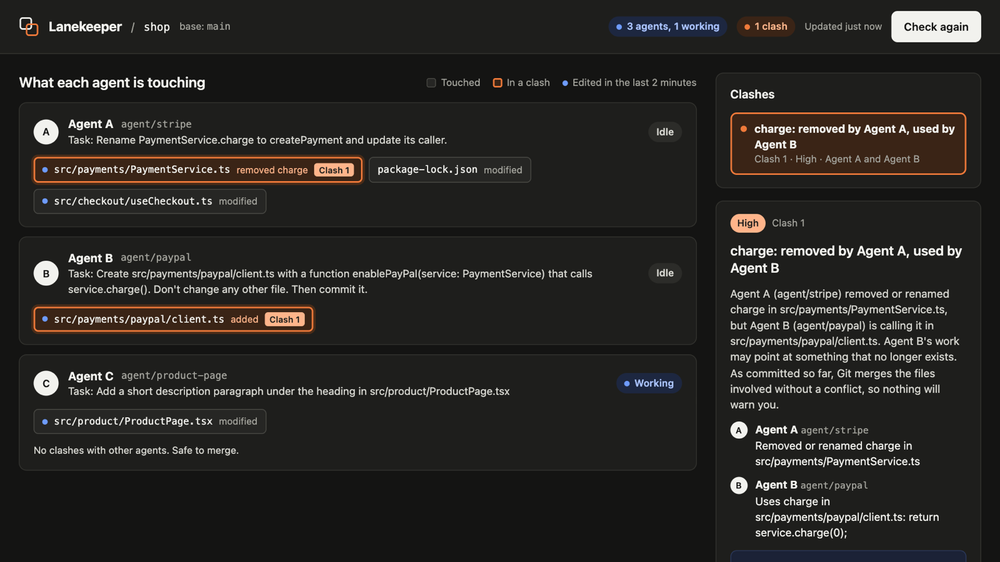

<div align="center">


# Lanekeeper

**Keeps your parallel Claude Code agents in their lanes.**<br>
A live map of what each agent is touching, with clashes caught before you merge.

[](https://github.com/osamaabid03/lanekeeper/releases)
[](LICENSE)


[▶ Watch the 70-second demo](https://github.com/osamaabid03/lanekeeper/releases/download/v0.1.0/lanekeeper-demo.mp4) ·
[Install](#install) · [Use](#use) · [Try the demo](#try-the-demo) · [Privacy](#data-and-privacy)



</div>

## The problem

Running several agents at once, each in its own git worktree, stops them overwriting each other's files. It doesn't
stop them making changes that can't both be true. Git compares text, not intent, so contradictory work merges cleanly
and breaks later:

```
agent/stripe   renames charge() to createPayment()          ─┐
agent/paypal   writes new code that calls charge()           ├─  git merge: clean    result: broken
                                                            ─┘
```

Lanekeeper watches every worktree of a repository and tells you, before you merge.

## Features

- 🗺️ **A live map**: one lane per agent, with its task and every file it has changed
- 🚨 **Clashes explained**: each in plain English, with a suggested fix
- 🔎 **Asks Git itself**: will this merge stop with a conflict, or go through silently?
- 🧭 **A suggested merge order**: clash-free work first, risky changes last
- 📋 **Copy note for agents**: paste the clash into each agent's session
- 🔒 **All local**: nothing is hosted, and your code never leaves your computer
- ⚡ **Zero setup**: install it, run one command

### How it differs from `git merge`

| | `git merge` | Lanekeeper |
| --- | --- | --- |
| **When** | At merge time | While the agents are still working |
| **Compares** | Lines of text | What each agent changed, across every worktree |
| **Stops for** | Edits to the same lines | Renamed-but-still-used code, same function, lockfiles, same file |
| **Does** | Merges | Detects and suggests. It never edits code or merges |

It complements your tests and type checker rather than replacing them: they find the break after the merge, and
Lanekeeper tells you while it's cheap to fix.

## What it detects

| Severity | Clash | Example |
| --- | --- | --- |
| 🔴 High | **Removed vs used**: one agent removes or renames a definition another agent is building on | Agent A renames `charge`; Agent B writes code that calls it |
| 🟠 Medium | **Lockfile**: both agents change the same dependency lockfile | Both add packages to `package-lock.json` |
| 🟠 Medium | **Same function**: both agents change the same function or class | Both edit `checkout()` |
| 🟡 Low | **Same file**: both agents change one file in different places | Both touch `routes.ts` |

Each clash also says whether Git itself will warn you: it asks `git merge-tree` about the two branches' committed work
and tells you if the merge will stop with a text conflict, or go through silently. Uncommitted changes can't be checked
this way, and the clash says so.

### Languages

| What | Where it works |
| --- | --- |
| Removed or renamed functions and methods | JavaScript, TypeScript, Python, Go and Rust. Also Ruby, PHP, Swift, Scala and Elixir, through the same patterns |
| Removed or renamed classes, interfaces, enums and structs | Any language that uses those keywords |
| Not detected yet | Methods in Java, C#, C and C++, and Kotlin's `fun`. These fall back to a same-file clash |
| Lockfile, same-file and Git merge checks | Any language |

Definition detection is pattern-based, so treat findings as leads.

## Install

> [!NOTE]
> Requires Node.js 18+ and git 2.38+. On older git everything still works, but Lanekeeper can't tell you whether Git
> itself will flag a clash at merge time.

From GitHub:

```
/plugin marketplace add osamaabid03/lanekeeper
/plugin install lanekeeper@lanekeeper
```

From a local folder while developing:

```
claude --plugin-dir ./lanekeeper
```

## Use

1. Start agents in their own worktrees, for example `claude --worktree stripe` and `claude --worktree paypal`.
2. In any of them (or your main checkout), run `/lanekeeper:clashes`. Claude starts the map and gives you the link,
   usually `http://127.0.0.1:4777`, and summarizes any clashes.
3. Pick a clash to read what happened. **Copy note for agents** copies a message you can paste into each agent's
   session; **Mark as fine** hides it.

Outside Claude Code, from any worktree:

```
node scripts/check.mjs          # text report; exit code 1 if High or Medium clashes
node scripts/check.mjs --json   # machine-readable
node scripts/start.mjs --open   # start the map and open it
node scripts/start.mjs --stop   # stop the map
```

Options: `--base <branch>` (defaults to origin's default branch, then main, master, trunk, develop),
`LANEKEEPER_PORT` (default 4777).

## Try the demo

Build a small repository where one agent has already renamed a method, then let a second agent call it:

```
./examples/make-demo-repo.sh ~/lanekeeper-demo
cd ~/lanekeeper-demo/shop && node /path/to/lanekeeper/scripts/start.mjs --open
```

The map opens showing one agent and no clashes. In two more terminals, start agents in the other worktrees:

```
cd ~/lanekeeper-demo/shop-paypal && claude --plugin-dir /path/to/lanekeeper
cd ~/lanekeeper-demo/shop-product-page && claude --plugin-dir /path/to/lanekeeper
```

Give the first agent: *"Create src/payments/paypal/client.ts with a function enablePayPal(service: PaymentService)
that calls service.charge(). Don't change any other file. Then commit it."* and the second: *"Add a short description
paragraph under the heading in src/product/ProductPage.tsx."* A High clash appears on the map while the first agent
works: stripe renamed `charge`, paypal calls it, and Git merges the two without complaint.

## How it works

- **Hooks** (`hooks/hooks.json`) run in the background on session start, each prompt, each file edit and each stop.
  They record which worktree an agent works in, its task and the files it edits. They never block Claude.
- **Store**: events are appended to `.git/lanekeeper/events.jsonl` in the shared git directory, so every worktree sees
  them.
- **Detector** (`lib/detect.mjs`) diffs each worktree, including uncommitted work, against the point where it branched
  from the base branch, then compares the agents pairwise.
- **Map** (`server/server.mjs`, `ui/index.html`): a local-only server on `127.0.0.1` that refreshes every few seconds
  and stops itself after two hours without visitors.

No dependencies beyond Node.js and git.

## Data and privacy

- **What the hooks record**, for each event: the worktree path, branch, session id, the first 400 characters of each
  prompt you type (shown as that agent's task; prompts starting with `/` are skipped), and the path of each file an
  agent edits. File contents are never stored.
- **Where it lives**: `.git/lanekeeper/events.jsonl` in the repository's own git directory. It is trimmed automatically
  once it passes 2 MB, and deleting the `lanekeeper` folder there removes everything.
- **Nothing leaves your machine**: no network requests, no telemetry. The map is served on `127.0.0.1` only.
- **Commands it runs**: read-only `git` commands (`diff`, `status`, `worktree list`, `merge-base`, `rev-parse`) and
  `git merge-tree --write-tree`, which writes unreferenced objects into the git object store (`git gc` removes them).
  It also starts its own local server and, on request, opens your browser.

## Limits

- Pattern-based detection can miss renamed concepts and can flag compatible work. Treat findings as leads.
- It sees committed and uncommitted changes in worktrees on this machine only.
- It suggests fixes; it never edits code or merges anything.
- Windows is untested.

## Development

```
node --test        # runs the tests; no dependencies to install
```

## License

[MIT](LICENSE) © Osama Abid
